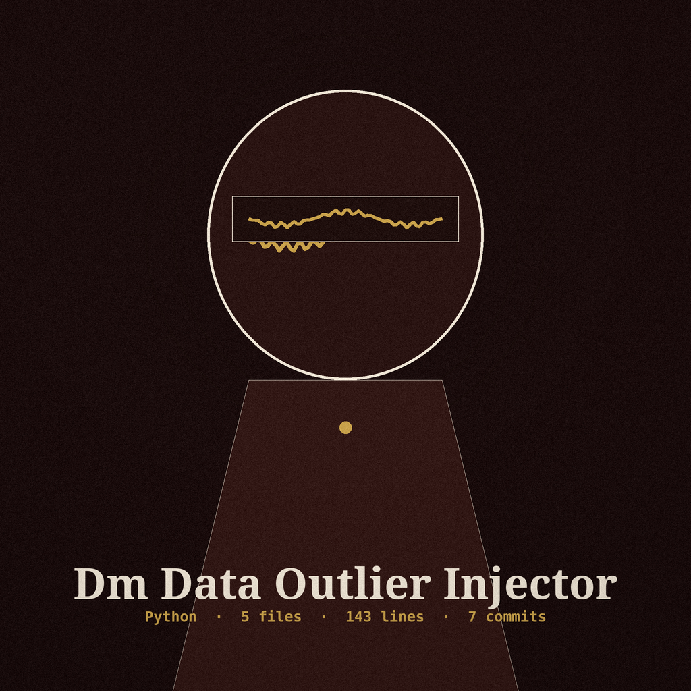

# dm-data-outlier-injector

Catalogue entry, author first: ShadowGuard-AI, dm-data-outlier-injector, a date stamp ritual at the returns desk. The name above is set in Caladea, with a small date stamp picture at the left of this first heading only. Later headings keep the catalogue style and drop the picture.

# dm-data-outlier-injector
Injects statistically plausible outlier data points into numerical columns to distort distributions and mask genuine outliers. Takes number of outliers, column, and standard deviation multiplier as arguments. - Focused on Tools designed to generate or mask sensitive data with realistic-looking but meaningless values

## Install
`git clone https://github.com/ShadowGuard-AI/dm-data-outlier-injector`

> Loan card: the clone line above keeps the organisation name in its published form, without its hyphen. It is preserved here exactly as printed. The website carries the corrected line, labelled as a correction.

## Usage
`python3 main.py input_file output_file column_name num_outliers std_multiplier [options]`

> Loan card: the description names three arguments, count, column, and standard deviation multiplier, and the parameters block below documents none of them. No flag name, no order, and no default is invented here to close that gap.

## Parameters
- `-h`: Show help message and exit

> Loan card: the parameters block documents help alone, while the description names three arguments. That gap comes from the source record, and it is printed here at full size rather than papered over.

## Output path and column spread

The output file must not be the input file. If the resolved output path equals the resolved input path, the run refuses at exit 1 before any write, including when the same file is named through a ./ alias or a symlink.

> Loan card: output must never resolve to the input, refusal at exit 1 before any write.

If the named column has no spread, meaning its standard deviation is zero or undefined (a single row, a constant column, or a non-numeric column), the run exits 1 with an error naming that no outlier can be drawn from a column with no spread, before writing any output.

> Loan card: a column with no spread ends the run at exit 1 with nothing written.

## License
This project is released under the MIT License. See the [LICENSE](LICENSE) file for details.

> Loan card: the closing line above keeps its published form, without its hyphen, and it stands apart from the repository LICENSE file, which holds MIT terms under a different holder wording.

## Filed at the returns desk

The main button of this re-skin reads Add the Outliers. Its count field label reads Number of Outliers. Its column field label reads Numerical Column. Its no spread heading reads No Spread, No Outlier. It ends with the stamp back on its rest, the loan card filed into the drawer, the drawer shut, the edition complete and the press at rest.
